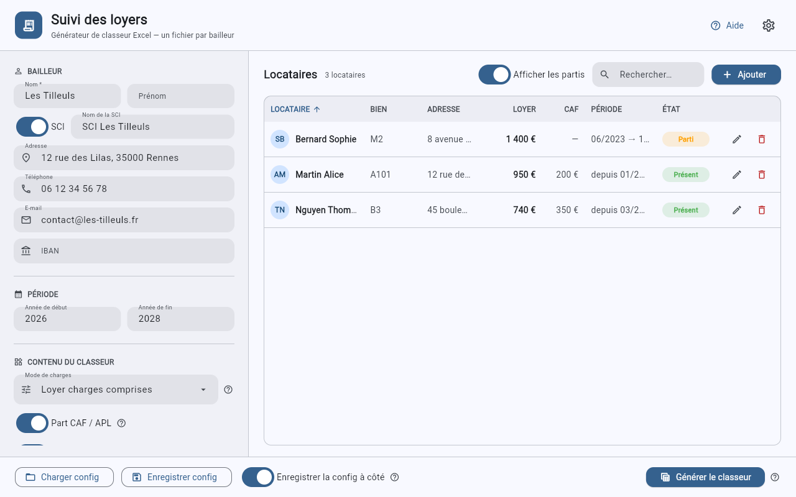
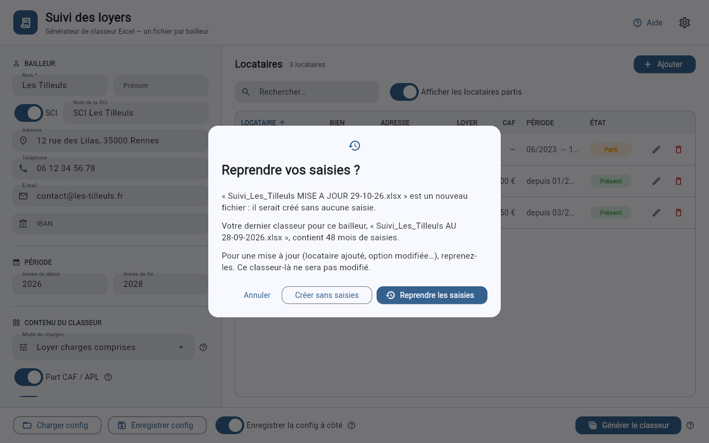
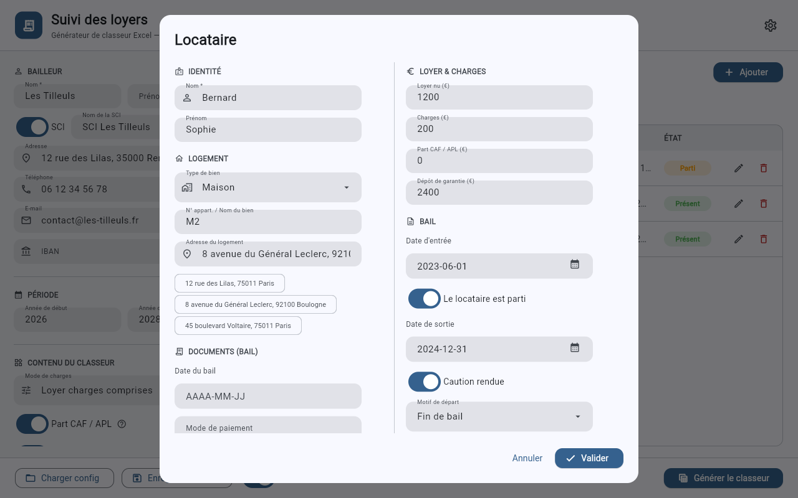
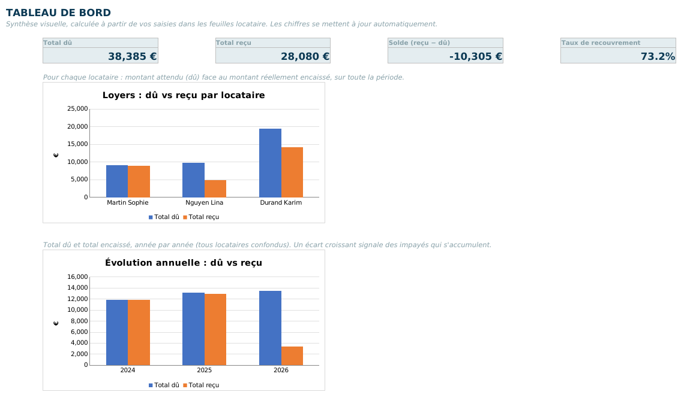
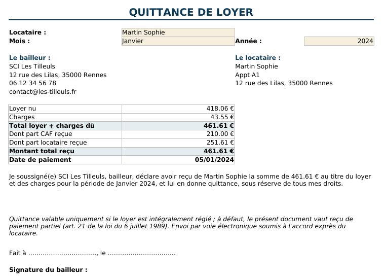
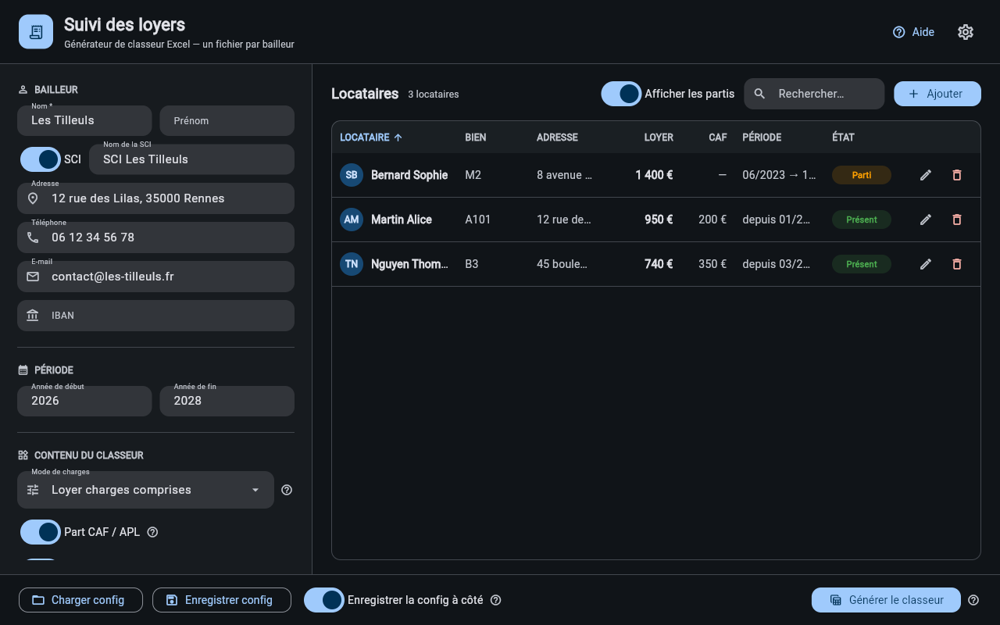
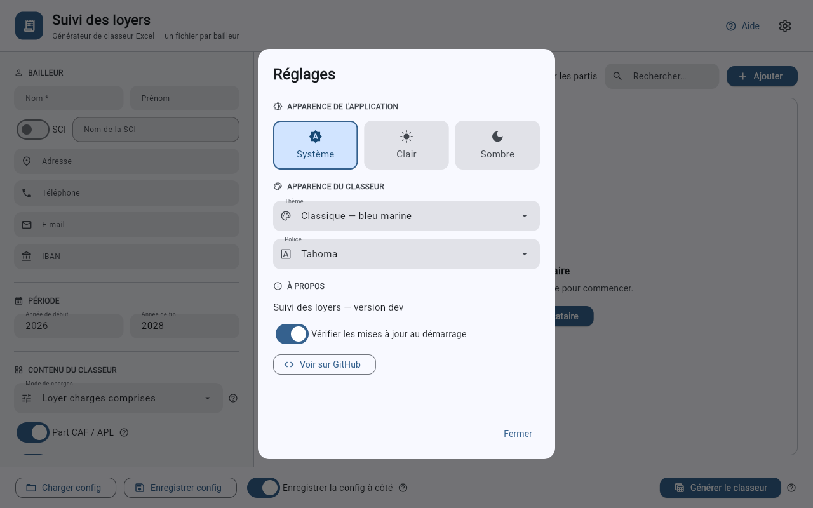

# Suivi des loyers

Génère un classeur Excel pour suivre, mois par mois, les loyers encaissés auprès de chaque
locataire et de la CAF. On remplit un formulaire (bailleur, locataires, options), on clique sur
un bouton, et le classeur est prêt. Chaque bailleur a son propre fichier. Le logiciel tourne
sous Windows et sous Linux, sans rien installer.



## Télécharger

Les versions se trouvent sur la page des
[releases](https://github.com/SckyzO/suivi-loyers/releases/latest) :

- **Windows** : `SuiviLoyers-windows.zip`. Décompressez-le, puis double-cliquez sur
  `SuiviLoyers.exe`. Au premier lancement, Windows peut afficher un avertissement bleu
  (SmartScreen) : la notice `LISEZ-MOI.txt` incluse explique comment passer outre.
- **Linux** : `SuiviLoyers-linux-x86_64.tar.gz`. Décompressez-le, puis lancez
  `./SuiviLoyers`. Il faut une distribution avec une glibc 2.36 ou plus récente (Debian 12,
  Ubuntu 24.04, Fedora 37 et suivantes) et un bureau graphique.

Au démarrage, le logiciel vérifie s'il existe une nouvelle version et propose de la
télécharger. Cette vérification se désactive dans les **Réglages** (roue crantée en haut à
droite).

## Régénérer sans perdre ses saisies

Pour mettre à jour un classeur (ajouter un locataire, changer une option…), régénérez-le
**sur le même fichier**. Le logiciel retient le dernier classeur généré pour chaque
bailleur et le propose d'office. En le remplaçant, il :

1. reprend automatiquement tout ce que vous aviez saisi : les montants reçus et les dates
   de chaque mois, les charges réelles de la régularisation et les indices IRL ;
2. garde une copie de l'ancien fichier à côté du nouveau, nommée
   `<nom du classeur>.bak-<date et heure>.xlsx`. En cas de doute, cette copie contient
   exactement ce que vous aviez avant. Si elle ne peut pas être créée, rien n'est remplacé.

Si vous choisissez un autre fichier (un nouveau nom, ou un fichier sans saisies), le
logiciel demande d'abord d'où reprendre les saisies. Le classeur d'origine n'est jamais
modifié. Pour garder une version datée, copiez simplement le fichier.



Après chaque génération, un compte rendu indique ce qui a été repris et le nom de la copie
de sécurité. Les saisies sont rattachées au nom et prénom du locataire, à l'année et au
mois : celles qui n'ont plus de place dans le nouveau classeur (locataire renommé ou
supprimé, mois sorti de la période, option CAF désactivée…) sont signalées, avec le fichier
où elles restent.

Ce que vous saisissez dans le logiciel (bailleur, locataires, options) est sauvegardé en
continu. S'il est fermé avant d'avoir généré le classeur ou enregistré la configuration, il
propose de reprendre cette saisie au lancement suivant. Une saisie que vous ne reprenez pas,
ou que vous remplacez en chargeant une autre configuration, est mise de côté : les
**Réglages** la listent avec un bouton **Reprendre**, et elle n'est jamais effacée.

Le bouton **Aide**, en haut à droite, ouvre un mode d'emploi. Il s'affiche tout seul au
premier lancement.

## Utiliser le logiciel

1. Renseignez le bailleur (au minimum son nom ; activez *SCI* pour une société) et la
   période (année de début et de fin).
2. Choisissez le contenu du classeur :
   - *Mode de charges* : *Loyer charges comprises*, *Loyer + charges séparés*, ou *Loyer seul
     (sans charges)*.
   - *Part CAF / APL* : si une partie du loyer est versée directement par la CAF.
   - *Dépôt de garantie*.
   - *Documents (quittance, avis…)* : ajoute les documents à imprimer.
   - *Tableau de bord* : un onglet de synthèse avec graphiques.
   - *Régularisation des charges* et *Révision IRL* : voir plus bas.
3. Ajoutez les locataires avec le bouton **Ajouter**.
4. Cliquez sur **Générer le classeur** et choisissez où l'enregistrer. Le logiciel affiche
   ensuite un compte rendu et propose d'ouvrir le dossier qui contient le classeur.

Si l'interrupteur **Enregistrer la config à côté** est activé (c'est le cas par défaut), le
logiciel écrit aussi un fichier `.json` du même nom que le classeur. C'est votre
configuration : bouton **Charger config** pour la rouvrir plus tard, **Enregistrer config**
pour l'enregistrer ailleurs.

### La fiche locataire



- *Nom* et *Prénom* (deux champs séparés).
- *Type de bien* (appartement ou maison) et *N° appart. / Nom du bien*. L'onglet du locataire
  porte ce nom suivi du nom du locataire (« A101 - Martin Alice »), ce qui évite les doublons
  quand un même logement a eu plusieurs locataires.
- *Adresse du logement* : cliquez sur une adresse déjà saisie (pratique pour plusieurs
  appartements d'un même immeuble) ou tapez-en une nouvelle.
- Les montants et la *date d'entrée*. Les mois d'entrée et de sortie incomplets sont
  calculés au prorata des jours.
- *Le locataire est parti* : active la *date de sortie*, *Caution rendue* et le *motif de
  départ* (fin de bail, loyer impayé, travaux…, ou un texte libre).
- Avec l'option *Documents*, trois champs repris sur les courriers : *Date du bail*, *Mode de
  paiement* et *Jour d'échéance*.

### La liste des locataires

La liste se trie en cliquant sur l'en-tête d'une colonne, et se filtre avec le champ
**Rechercher** (nom, prénom, bien ou adresse). L'interrupteur **Afficher les partis**
masque les anciens locataires de la liste. Il ne touche qu'à l'affichage : le classeur les
garde tous, avec leur historique.

Supprimer un locataire demande une confirmation : ses saisies ne seraient plus reportées
dans le classeur. Pour un locataire qui part, indiquez plutôt une date de sortie.

Dans une fenêtre étroite, la liste masque les colonnes les moins utiles (Adresse, puis CAF,
Période et Bien) pour garder le nom, le loyer et l'état lisibles, et la recherche passe sous
le titre avec l'interrupteur et le bouton **Ajouter**. Agrandissez la fenêtre pour retrouver
les colonnes.

### Changer de locataire

Les rotations de locataires sont prévues. Pour un logement qui change d'occupant, mettez une
date de sortie à l'ancien et ajoutez le nouveau avec sa date d'entrée. Chacun
n'apparaît dans le suivi que sur ses mois de présence. Régénérez ensuite par-dessus le même
classeur : vos saisies sont reprises (voir plus haut).

## Le classeur produit

| Onglet | Contenu |
|---|---|
| **Guide** | Mode d'emploi du classeur. |
| **Locataires** | La fiche de chaque locataire (référentiel). |
| **Un onglet par locataire** | Le suivi mois par mois : c'est là que vous saisissez. |
| **Bilan** | Évolution année par année, synthèse par locataire, détail de chaque année. |
| **Tableau de bord** | Totaux et graphiques (option). |
| **Régularisation charges**, **Révision IRL** | Voir plus bas (options). |
| **Quittance**, **Avis d'échéance**, **Lettre de relance**, **Mise en demeure** | Documents à imprimer (option). |

Dans l'onglet d'un locataire, saisissez chaque mois les montants reçus et leurs dates dans
les cases jaunes. Le reste (dû, écarts, statut, totaux, bilan) se calcule tout seul : ne
modifiez pas les cases bleutées. Un total est ajouté à la fin de chaque année.

| Statut | Couleur | Signification |
|---|---|---|
| Soldé | vert | Le total reçu couvre le total dû. |
| Trop-perçu | orange | Reçu supérieur au dû (avance, régularisation à prévoir). |
| Partiel | rouge | Reçu inférieur au dû (impayé partiel). |
| À encaisser | gris | Aucun paiement saisi pour ce mois. |



### Imprimer un document

Dans les onglets **Quittance**, **Avis d'échéance**, **Lettre de relance** et **Mise en
demeure**, choisissez le locataire, le mois et l'année : le document se remplit et
s'imprime. Si le loyer du mois n'est pas entièrement payé, la quittance devient
automatiquement un reçu de paiement partiel (article 21 de la loi du 6 juillet 1989). La
relance et la mise en demeure indiquent le reste dû cumulé du locataire.



### Régulariser les charges

L'onglet **Régularisation charges** affiche, pour chaque locataire et chaque année, les
provisions de charges appelées. Saisissez les charges réelles dans la case jaune : le
solde s'affiche, avec la marche à suivre (équilibré, complément à demander ou somme à
rembourser).

### Réviser le loyer (IRL)

Dans l'onglet **Révision IRL**, saisissez les indices IRL publiés par l'INSEE (année,
trimestre, valeur). Le classeur calcule alors le loyer applicable chaque année pour chaque
locataire, à partir du loyer de sa fiche et du trimestre de sa date d'entrée, et le reporte
dans le loyer attendu de ses mois. Seul le loyer est révisé, pas les charges ni la CAF. Tant
qu'un indice manque, le loyer de la fiche s'applique sans révision.

## Apparence

Les **Réglages** choisissent le thème de l'application (système, clair ou sombre) et
l'apparence du classeur : thème de couleurs et police.

| Thème sombre | Réglages |
|---|---|
|  |  |

---

## Pour le mainteneur

Tout passe par Docker, rien à installer localement. `make` enchaîne le build de l'image, le
lint (ruff), la génération des classeurs d'exemple dans `exemples/`, les tests et la
synchronisation vers le dossier Windows.

```bash
make            # build + lint + exemples + tests + sync
make test       # smoke test du moteur
make test-ui    # fonctions pures de l'interface (filtrage, reprise, protection de la saisie)
make linux      # binaire Linux -> dist/linux/SuiviLoyers
```

Le moteur (`generer_suivi_loyers.py`) lit une configuration et écrit le `.xlsx`.
L'interface (`interface_flet.py`, [Flet](https://flet.dev)) assemble la configuration et
appelle ce moteur. Le moteur s'utilise aussi seul :

```bash
docker compose build
docker compose run --rm suivi configs/exemple.yaml exemples
```

Les formules sont écrites avec les noms de fonctions anglais (`SUMIFS`, `VLOOKUP`, `IF`) :
Excel les affiche en français et LibreOffice les lit sans souci.

### Construire les exécutables

- Windows : sous Windows, avec [Python](https://www.python.org/downloads/) 3.10 ou plus
  et [uv](https://docs.astral.sh/uv/), double-cliquez sur `build-flet.bat`. L'exécutable
  arrive dans `dist\SuiviLoyers.exe`.
- Linux : `make linux`, dans Docker.
- Release : pousser un tag `v*` (par exemple `git tag -a v1.2.0 && git push origin
  v1.2.0`). Le workflow `build.yml` construit les deux versions, lance le binaire Linux sous
  Xvfb pour vérifier qu'il démarre, puis publie les deux archives dans une même release.

### Structure du projet

| Fichier | Rôle |
|---|---|
| `generer_suivi_loyers.py` | Moteur : construit le classeur à partir d'une configuration. |
| `interface_flet.py` | Interface graphique (Flet). |
| `configs/` | Configurations d'exemple (`exemple.yaml`, `minimal.yaml`). |
| `tests/` | `smoke.py` (moteur), `ui_filtres.py`, `ui_reprise.py` et `ui_protection.py` (fonctions de l'interface), `verrou_windows.py` (classeur ouvert dans Excel, Windows seulement). |
| `build-flet.bat` | Construit `SuiviLoyers.exe` sous Windows. |
| `Dockerfile.linux`, `packaging/` | Build du binaire Linux et son runtime hook PyInstaller. |
| `Dockerfile`, `docker-compose.yml` | Environnement du moteur (génération, tests). |
| `.github/workflows/` | CI (lint + tests sous Linux et Windows) et build des exécutables. |

### Modules de la configuration

| Clé (`modules:`) | Défaut | Effet |
|---|---|---|
| `mode_charges` | `comprises` | `comprises`, `separees` ou `sans`. |
| `caf` | `true` | Colonnes part CAF attendue / reçue. |
| `depot_garantie` | `true` | Dépôt de garantie dans la fiche locataire. |
| `documents` | `true` | Quittance, avis d'échéance, relance, mise en demeure. |
| `tableau_bord` | `true` | Onglet Tableau de bord. |
| `regularisation_charges` | `false` | Onglet Régularisation charges. |
| `irl` | `false` | Onglet Révision IRL et loyer révisé par année. |

Une option désactivée retire ses colonnes et ses onglets sans casser les formules. Les
configurations d'anciennes versions sont converties au chargement.

L'historique des versions est dans [CHANGELOG.md](CHANGELOG.md).
